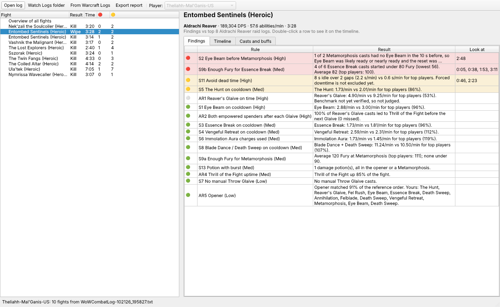
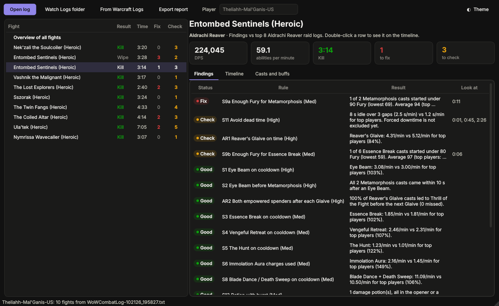
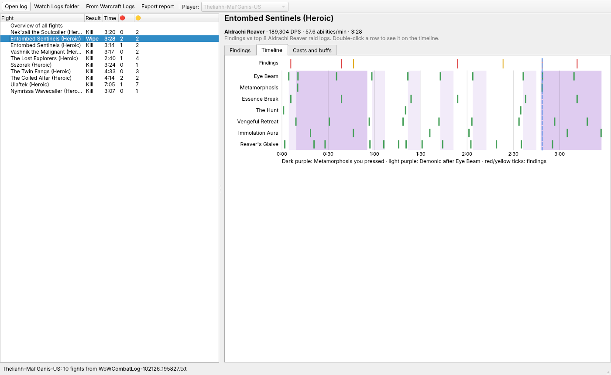
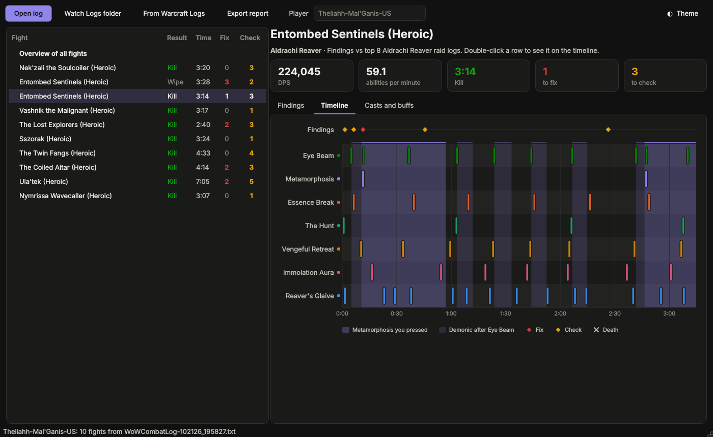
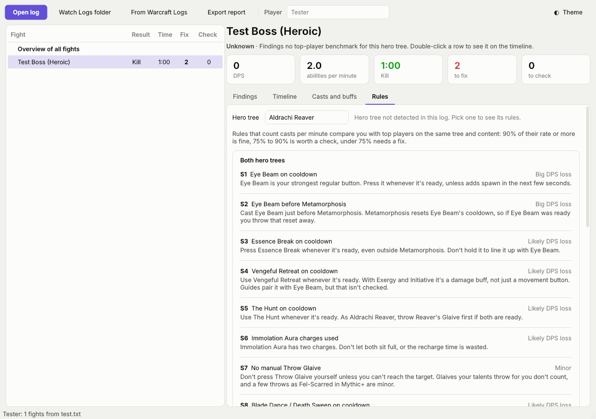

# Havoc DH Analyzer

Finds mistakes and improvements in Havoc Demon Hunter play from World of Warcraft combat logs, per raid boss pull and per Mythic+ key, with rules for both Aldrachi Reaver and Fel-Scarred.

## Layout

- `havoc_gui/` - the PySide6 desktop app; `havoc_analyzer.spec` builds it with PyInstaller.
- `havoc_analyzer/` - the analyzer (Python 3.10+, standard library only):
  - `events.py` - the shared event and fight model.
  - `combatlog.py` - raw `WoWCombatLog.txt` parser (boss pulls and Mythic+ keys).
  - `wcl_source.py` - loads one Warcraft Logs fight into the same model.
  - `summary.py` - per-fight data: pressed casts, real Metamorphosis windows, uptimes, idle time.
  - `rules.py` - the ruleset checks; `benchmarks.py` - top-player medians; `report.py` - runs them and writes the report.
- `tests/` - unit tests: `python -m unittest discover -s tests -t .`
- `wcl/` - Warcraft Logs v2 API client, top-player rankings and benchmarks. Needs `WCL_CLIENT_ID` and `WCL_CLIENT_SECRET` in the environment; never commit them.
- `docs/ruleset.md` - the rules the analyzer checks, each tied to a source.
- `docs/wcl-findings.md` - top-log benchmarks and the raw log vs. API comparison.
- `docs/sample-report-2026-10-21.md` - example output.

## Desktop app

- **Open log…** reads a `WoWCombatLog*.txt` (about 8 s for a 600 MB raid night).
- **Watch Logs folder** loads the newest log and reloads it about 20 s after each pull ends.
- **From Warcraft Logs…** loads a report link (add `#fight=N` for one pull). It needs your WCL v2 client ID and secret, which are saved only in your user settings on this computer.
- Pick a pull or key on the left to see its findings. Double-click a finding to see it on the **Timeline**, which shows the key cooldowns with pressed Metamorphosis and Demonic windows shaded.
- **Casts and buffs** charts damage by ability, buff uptime and pressed casts for the pull; on the overview it charts DPS per fight and the rules that came up most.
- **Rules** lists every rule for the hero tree you played, shared rules first, each with a short plain explanation. It follows the tree detected in the log; pick the other tree to compare. Rules that aren't checked yet are listed at the bottom.
- **Export report…** saves the Markdown report.
- **Theme** switches between light, dark, or matching Windows (the default). The choice is remembered.

**Windows download:** every push builds `HavocAnalyzer.exe`. Open the repo's Actions tab, pick the latest **build-app** run, and download the `HavocAnalyzer-windows` artifact.

**Run from source:**

    pip install -r requirements.txt
    python -m havoc_gui [path/to/WoWCombatLog.txt]

## Command line

    python -m havoc_analyzer path/to/WoWCombatLog.txt --out report.md

The report lists, for every boss pull and key, each rule as 🔴 likely DPS lost, 🟡 worth a look, 🟢 fine or ⚪ measured only, with timestamps to look at, plus an overview of rules that came up across fights.

Turn on Advanced Combat Logging in game. Built against COMBAT_LOG_VERSION 22, build 12.1.5. Mythic+ splitting is written but not yet tested on a real key.
